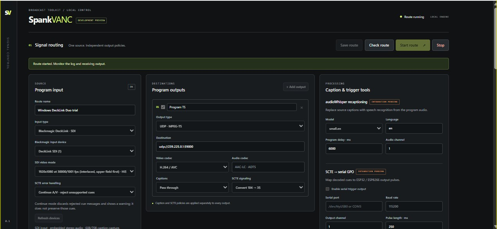
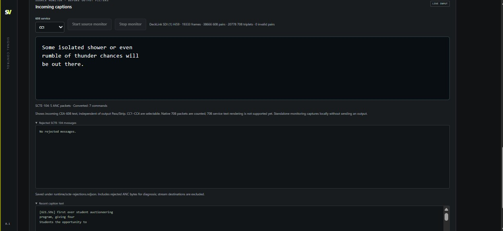
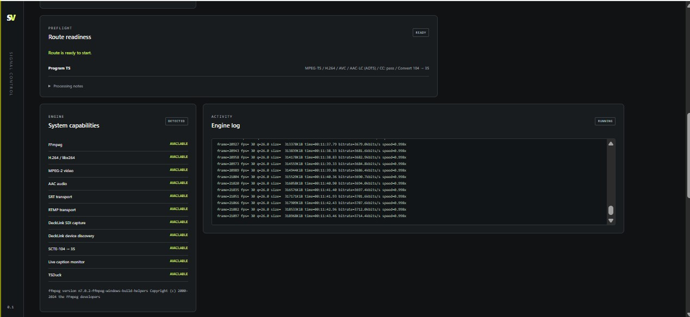

# SpankVANC

A local broadcast routing and monitoring app for DeckLink SDI, captions and
SCTE cues. Python serves a browser control panel on **127.0.0.1:8877**; media
processing runs in a separately installed FFmpeg. Media and control remain local. No activation key, trial timer or online license check is required.

**Version 0.15.1 — experimental.** Test on a spare route before using a live
program. CPU encoding is used; an NVIDIA GPU is not required.

SpankVANC takes one program source and routes it to as many as eight outputs.
Use it to monitor incoming closed captions, pass or remove existing captions,
generate new captions from program audio, translate English captions to Spanish
CC2, and preserve, convert or manually insert supported SCTE cues. Each output
has its own policies, so one source can feed SDI, a transport-stream recording
and a YouTube stream with different caption and cue settings.

**New in 0.15.1:** choose **NULL · EN530 serial only** to send recognized captions
to an EN530 without video/audio playout. This release also includes the
OpenAI Whisper / Faster Whisper backend selector, overlapping-window word
deduplication and optional EN530 serial mirroring introduced in 0.15.0.
See the [change history](CHANGELOG.md) and [caption guide](docs/WHISPER.md).

## Windows downloads

**Current tester release: 0.15.1 — Windows 11 x64.** Start with the guided
installer for a new PC, or use the portable ZIP if you already have the required
engines and dependencies.

| Download | Use | Verify |
| --- | --- | --- |
| [Windows Setup EXE](https://github.com/videoengineeringtutorials-wq/SpankVANC/releases/download/v0.15.1/SpankVANC-0.15.1-Windows11-x64-Setup.exe) | Guided installation and repair | [SHA-256](https://github.com/videoengineeringtutorials-wq/SpankVANC/releases/download/v0.15.1/SpankVANC-0.15.1-Windows11-x64-Setup.exe.sha256) |
| [Windows portable App ZIP](https://github.com/videoengineeringtutorials-wq/SpankVANC/releases/download/v0.15.1/SpankVANC-0.15.1-Windows11-x64-App.zip) | Extract and run with bundled Python | [SHA-256](https://github.com/videoengineeringtutorials-wq/SpankVANC/releases/download/v0.15.1/SpankVANC-0.15.1-Windows11-x64-App.zip.sha256) |

[0.15.1 release notes](https://github.com/videoengineeringtutorials-wq/SpankVANC/releases/tag/v0.15.1)
· [All releases and previous Windows downloads](https://github.com/videoengineeringtutorials-wq/SpankVANC/releases)
· [Windows installation guide](docs/WINDOWS_INSTALLER.md)

The installer downloads dependencies and builds the media engine locally.
FFmpeg, Blackmagic SDK files and drivers are supplied separately. The **source
ZIP** on the release page is for developers and does not include the portable
Python runtime.

## Screenshots

These screenshots show an earlier development build running on Windows; labels
and available controls have changed since then. Click an image to view it full size.

**Signal routing and output policies**

[](docs/screenshots/signal-routing.jpg)

**Live incoming captions and SCTE monitoring**

[](docs/screenshots/live-captions.jpg)

**Route readiness, system capabilities and engine activity**

[](docs/screenshots/engine-status.jpg)

## Get running

SpankVANC is MIT-licensed open source. Internet access is needed for setup downloads, not for application activation or local operation.

**Windows testers: [download the 0.15.1 Setup EXE](https://github.com/videoengineeringtutorials-wq/SpankVANC/releases/download/v0.15.1/SpankVANC-0.15.1-Windows11-x64-Setup.exe)**
([release notes and checksums](https://github.com/videoengineeringtutorials-wq/SpankVANC/releases/tag/v0.15.1)).
It installs the app and opens a guided wizard for isolated Python/Whisper/Torch,
build prerequisites and a local DeckLink engine build. See the
[step-by-step installer guide](docs/WINDOWS_INSTALLER.md). Blackmagic downloads,
administrator approval and a restart may still be needed. This is an online
installer; no compiled FFmpeg, SDK or driver is bundled.

YouTube outputs offer 6, 8, 10 or 14 Mbit/s. Existing routes default to 14;
choose a lower rate such as 8 when the upload path cannot sustain it with headroom.

**New Windows user with just a PC and a card? Start with the
[complete beginner setup guide](docs/WINDOWS_BEGINNER.md).** It covers downloads, card drivers, the first recording, the local engine build,
and optional generated captions. The Windows ZIP includes **START HERE.html**.

- **Windows 11:** download the **Windows x64 App** ZIP from
  [Releases](https://github.com/videoengineeringtutorials-wq/SpankVANC/releases),
  extract it completely, and run **Start SpankVANC.cmd**. Python is included;
  FFmpeg and Blackmagic Desktop Video are installed separately.
- **Linux / source:** install Python 3.11+ and FFmpeg, then run
  `python3 -m spankvanc serve` from this checkout. Open the local browser URL.
- For local caption monitoring/SCTE conversion, **Build Extended Capture.cmd**
  builds the engine on your own PC using Ubuntu/WSL and user-supplied SDK 12.8 files.
  See [the guided steps](docs/WINDOWS_BEGINNER.md#part-b--add-live-caption-monitoring-and-scte-conversion).
- Follow the [setup guide](docs/SETUP.md) for dependencies, device selection,
  first test, upgrades, logs and troubleshooting.

**Public downloads contain no FFmpeg binary, DeckLink SDK or driver installer.**
The pinned extended capture build uses FFmpeg's nonfree configuration and must
be built locally. See [redistribution audit](docs/REDISTRIBUTION.md) and
[third-party notices](THIRD_PARTY_NOTICES.md) before packaging dependencies.
Historical Extended trial ZIPs are not public release assets.

Choose the **Windows11-x64-Setup.exe** for guided installation, or the
**Windows11-x64-App.zip** for portable use.
The **source.zip** is for developers; GitHub’s automatic “Source code” downloads
do not include the portable Python runtime.

For SDI output, caption monitoring, SCTE conversion or Whisper replacement,
complete the beginner guide’s **Part B** local engine build. A stock FFmpeg
download provides only the basic path. Whisper also needs its own
[Python environment](docs/WHISPER.md#windows-installation-from-scratch).

## What the software does

### Route one source to multiple destinations

Select a DeckLink SDI input with embedded stereo audio, a local media file,
UDP or SRT MPEG-TS, or an RTMP/RTMPS source. Device and video-mode discovery
lists the DeckLink inputs and outputs exposed by the installed driver and engine.
File inputs can run at program speed for live-caption testing.

Enable up to **eight outputs** from the same source. Choose the transport,
video codec, caption policy and SCTE policy separately for each destination.
Save the route locally, check readiness, then start or stop it from the browser.

| Output | Video and audio | Typical use |
| --- | --- | --- |
| DeckLink SDI | Uncompressed V210 video, embedded PCM audio, supported caption/cue VANC | Feed an SDI receiver or downstream broadcast chain |
| UDP MPEG-TS | H.264 or MPEG-2 video; AAC-LC at 48 kHz / 192 kbit/s | Local/network transport; default 1316-byte aligned datagrams |
| SRT MPEG-TS | H.264 or MPEG-2 video; AAC-LC at 48 kHz / 192 kbit/s | Transport over an SRT connection |
| Local MPEG-TS file | H.264 or MPEG-2 video; AAC-LC at 48 kHz / 192 kbit/s | Record or inspect processed output |
| RTMP / RTMPS | H.264 video and AAC-LC in FLV | Send to a compatible streaming ingest |
| YouTube RTMPS | Progressive 1080p30 SDR H.264; stereo AAC-LC at 44.1 kHz / 128 kbit/s | Stream with the dedicated YouTube preset |
| NULL · EN530 serial only | No video/audio playout; captions sent over serial | Caption an EN530 without a video output device or destination |

SRT input and output offer **Caller, Listener and Rendezvous** modes while
retaining other URL options. YouTube has separate server and masked stream-key
fields, selectable **6 / 8 / 10 / 14 Mbit/s CBR**, a two-second GOP, and
deinterlacing/scaling to 1080p30. It expects SDR Rec.709 input; HDR tone mapping
is not implemented. See [YouTube setup](docs/YOUTUBE.md) and
[UDP troubleshooting](docs/UDP.md).

DeckLink capture and playout require compatible hardware, Desktop Video and a
locally built engine. Simultaneous input/output on one subdevice depends on its
active duplex profile; known half-duplex conflicts are blocked. Configure card
connectors in Desktop Video Setup. Caption playout regenerates supported CDPs
and does not preserve arbitrary ANC packets.

### Pass, strip or generate closed captions

On each video output choose **Pass through**, **Strip**, or
**audioWhisper · replace**, independently of its SCTE setting.

- **Pass through:** carry supported existing A/53 caption data. Select 608, 708
  or both to keep only the caption types already in the source.
- **Strip:** remove supported caption metadata from that output.
- **Replace:** recognize routed program audio and generate new **CEA-608 CC1**,
  **native CEA-708 Service 1**, or **608 + 708** captions. The generated display
  uses two-row roll-up with word wrapping and paced transmission.

Replacement uses the selected program audio channel, not a separate microphone
capture. Select channel 1 or 2, the model, language and CPU/Auto/CUDA processing.
Recognition runs locally in a separate speech Python environment; no cloud
transcription service or API key is used. GPU-required mode fails readiness
when CUDA is unavailable. Video encoding uses the CPU.

Choose **OpenAI Whisper** or **Faster Whisper**. Faster Whisper uses overlapping
four-second windows with a two-second hop, word timestamp deduplication and
a text-overlap fallback. Compute choices include Auto, float16, int8_float16,
int8 and float32, subject to backend/hardware support. The two backends use
different model caches/formats, so Faster Whisper may need its own initial
model download.

Speech recognition and caption transmission add delay. SpankVANC does not
delay program audio/video to compensate. Pass through does not create missing
caption services or convert source 608 text into native 708; stripping metadata
cannot remove text already burned into video. See
[caption setup, formats and limits](docs/WHISPER.md).

### Send captions directly to an EN530

Enter the EN530 serial port in the recaptioning panel. With a video replacement
output enabled, recognized captions can also be mirrored to the encoder.
For serial operation alone, choose **NULL · EN530 serial only**.

NULL keeps source audio flowing to Whisper and sends the resulting text to the
configured serial port. It needs **no video destination, output card or video
encoder**. The input source is still required; an SDI source still needs its
capture device and video mode. NULL can run alongside video outputs, sharing
one capture, recognition worker and serial connection.

The serial link uses **1200 baud, 7 data bits, odd parity, 1 stop bit (7O1)**,
32-character text wrapping and E1 recovery handling. A missing serial port,
serial failure or sustained queue overload is reported; a failed worker stops
the route. Serial sends source-language CC1 text and does not carry the optional
Spanish CC2 translation. Physical EN530 reception remains unverified.

### Add optional English-to-Spanish CC2

Install the optional local **OPUS-MT English → Spanish** runtime and model,
then enable **Add Spanish translation on CC2** on each desired replacement
output. English stays on CC1; Spanish uses CEA-608 CC2 with supported accented
letters and punctuation. Choose 608 or 608 + 708. Native 708 Service 1 remains
English; Spanish 708 Service 2 is not generated.

The Dashboard offers manual translation preview and live Whisper translation
history. Manual preview text is not transmitted. Translation adds latency;
bounded queues skip overloaded phrases and expose backlog/skip counts. CC1 and
CC2 share 608 bandwidth. The setting is optional per output and does not apply
to NULL serial output. See [Spanish CC2 details](docs/WHISPER.md).

### Preserve, convert and manually insert SCTE cues

Caption and SCTE policies are independent. The available cue choices follow
the input/output transport:

| Path | Supported cue handling |
| --- | --- |
| SDI → SDI | Pass or strip supported SCTE-104 |
| MPEG-TS → MPEG-TS | Pass or strip SCTE-35 |
| SDI → MPEG-TS | Convert supported SCTE-104 to SCTE-35, or strip |
| MPEG-TS → SDI | Convert supported SCTE-35 to SCTE-104, or strip |
| SDI or MPEG-TS output | Optional Manual SCTE mode with Start/End controls |
| RTMP, YouTube or NULL | No SCTE carriage |

Conversion includes supported program splice start/end, normal/immediate cues,
cancellation, duration, time_signal and raw descriptor handling, with
multi-command messages processed in source order. Conversion supports timestamp
type 0 only; see the guide for the exact operation/timing limits. TS inputs
offer optional SCTE-35 PID selection.

Choose **Continue A/V** to reject unsupported cues while retaining diagnostics,
or **Stop route** for strict rejection handling. Manual mode inserts cues on
the selected running output: SCTE-104 on SDI or SCTE-35 on TS. Set the break
duration and use **Start break / End break**; return to program is explicit.
RTMP and YouTube do not support these controls. See
[SCTE carriage, conversion and manual controls](docs/SDI_SCTE.md).

### Monitor the source and diagnose route readiness

The incoming caption panel displays **CEA-608 CC1–CC4**, caption history,
signal status, native 708 packet counters and SCTE activity. It observes the
source before output filtering. A standalone source monitor captures locally
without sending a program output. Native 708 text rendering is not implemented.

The readiness panel checks detected devices, codecs, filters, speech/translation
dependencies, output policies and duplex conflicts before starting a route.
The capabilities panel and engine log show installed support, worker failures
and runtime messages. Rejected SCTE diagnostics retain cue details for analysis.
Stream destinations are scrubbed from the command preview; saved routes can
still contain stream keys and must be kept private.

### Installation and current limits

The Windows 11 x64 guided installer supports install, repair and setup resume,
with an embedded app Python, isolated speech dependencies, optional translation,
and a local extended-engine build using WSL and user-supplied Blackmagic SDK
files. FFmpeg, SDKs, drivers and model weights are not bundled. Setup and initial
model downloads require Internet; local operation requires no activation check.

Use a current locally built extended engine for SDI VANC, live monitoring,
SCTE conversion and captions inserted into video. NULL avoids video encoder and
caption insertion requirements, but still needs an engine that can read the
chosen source and provide audio to Whisper.

General ANC transport and live SCTE-to-serial **GPO dispatch are not integrated**;
the firmware/native helpers are bench tools. EN530 caption serial output is a
separate implemented feature. Wider hardware coverage, physical EN530 and
Spanish CC2 reception, sustained translation throughput, and Faster Whisper
CUDA inference remain pending. Read the verification notes below before
planning a live deployment.

## Hardware and verification

User reports confirm original DeckLink Duo / Desktop Video 12.8 input discovery,
SDI capture, UDP output and live captions on Windows 11. A Linux Mini Recorder
was also used for input development. A live multi-command SCTE payload is covered
by regression tests. These observations do not establish compatibility with
every card, driver, format or caption source.

Actual Windows executable tests under Wine check synthetic caption/SCTE muxing,
progressive YouTube encoding and loopback UDP integrity. Wine does not validate
Blackmagic hardware or YouTube live acceptance. The 0.15.1 test-PC installer preserved settings, saved routes and both selected
media engines. Native NULL preflight passed for both speech backends, and an
audio-only MPEG-TS fixture produced mono 16 kHz float PCM without video output.
All 127 local unit/media tests and the GitHub Linux/native-Windows checks passed
for the 0.15.1 implementation. See the
[0.15.1 verification record](docs/verification/null-output-0.15.1.json) and
[earlier speech/installer checks](docs/verification/faster-whisper-0.15.0.json).

A reported multicast capture
with transport/continuity errors remains under investigation; see
[UDP troubleshooting](docs/UDP.md) and [test results](docs/TEST_RESULTS.md).

## Project continuity

Read [the current handoff](docs/PROJECT_HANDOFF.md) to resume development, including
implementation locations, build decisions, verified results and pending receiver
checks. Workstation-specific connection details are kept in a separate private
handoff excluded from public packages.

## Development

```bash
python3 -m unittest discover -s tests -v
cmake -S native -B build/native
cmake --build build/native
ctest --test-dir build/native --output-on-failure
```

Media tests need FFmpeg/ffprobe, g++, pkg-config and FFmpeg development libraries.
Browser checks use Playwright. See [contributing](CONTRIBUTING.md),
[change history](CHANGELOG.md), [architecture](docs/DESIGN.md),
[build instructions](docs/WINDOWS_EXTENDED_BUILD.md) and [source references](docs/SOURCES.md).

Saved routes may contain stream keys. Keep `runtime/`, `settings.json`,
recordings and diagnostics out of commits/issues. The server binds only to
loopback; do not expose it directly to the Internet. See [security](SECURITY.md).
